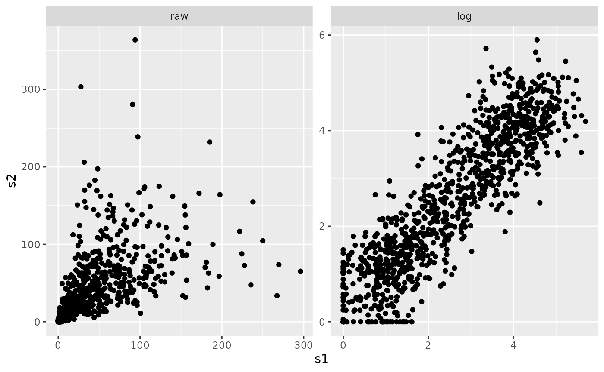
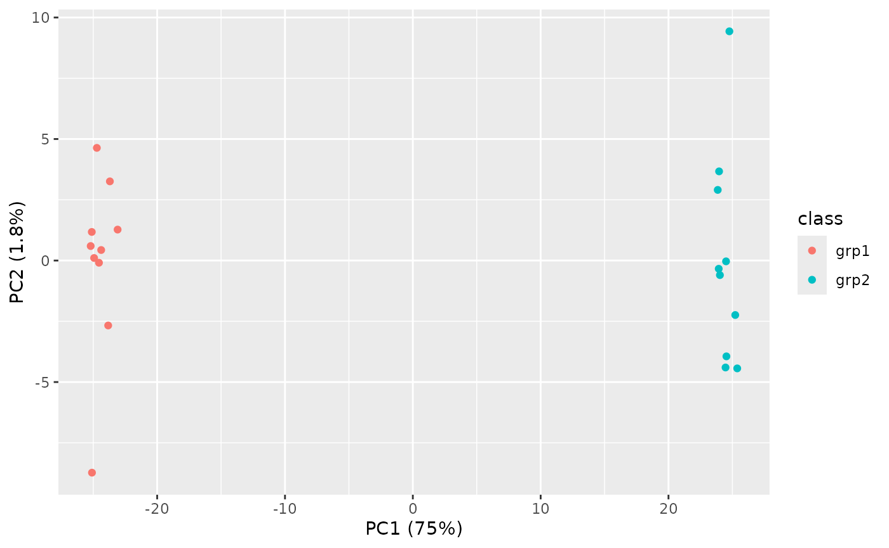
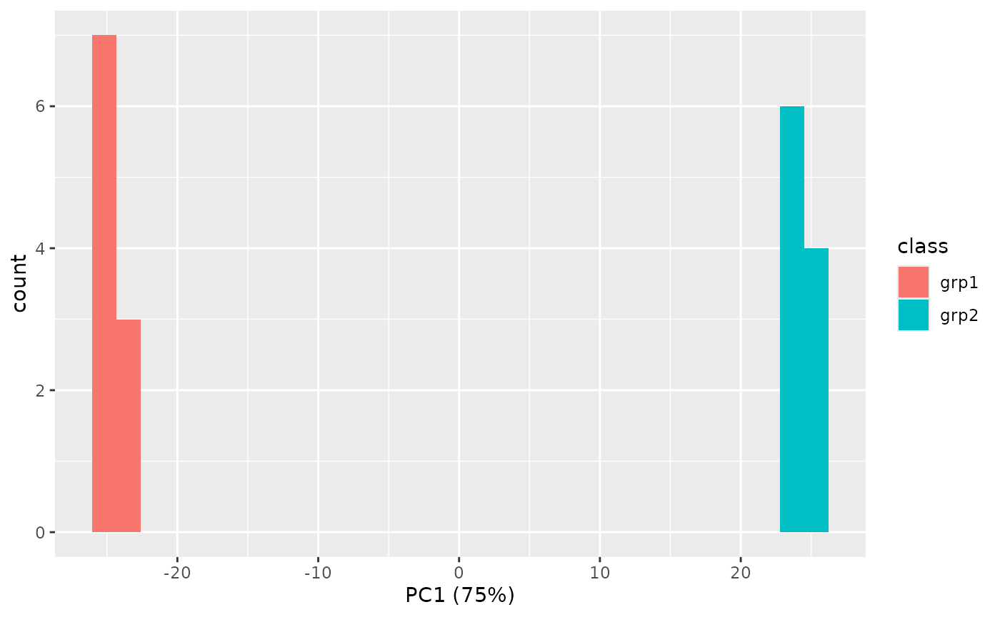

# PCA Testing

``` r

library(visualizationQualityControl)
library(ggplot2)
```

## Purpose

Principal components analysis (PCA) and related methods are very useful
data decomposition methods. However, when one has hundreds or thousands
of variables as many -omics methods do, any information beyond just
examining PC1 and PC2 is often lost.

However, there may be opportunities to examine the association of sample
scores on each principal component to see if they are associated with
any particular sample variable of interest. Following that, we can test
the loadings of the variables on that PC to see if any are significantly
associated with that PC. These variables may describe something
important about the data that doesn’t just come from statistically
significant differential differences.

## Data

The data we will use is completely artificial, in that the differences
are extreme and completely made up. We have 20 samples, 10 in each
class, and 1000 variables.

``` r

data("grp_exp_data")
data_matrix = grp_exp_data$data
rownames(data_matrix) = paste0("f", seq(1, nrow(data_matrix)))
colnames(data_matrix) = paste0("s", seq(1, ncol(data_matrix)))

sample_info <- data.frame(id = colnames(data_matrix), class = grp_exp_data$class)

dim(data_matrix)
#> [1] 1000   20
```

This data has a proportional variance structure, where the variance
increases with the value. We can see this by examining a plot of two
columns in raw and log-transformed values.

``` r

data_df = as.data.frame(data_matrix[, c(1, 2)])
data_df$type = "raw"
log_df = as.data.frame(log1p(data_matrix[, c(1, 2)]))
log_df$type = "log"

all_df = rbind(data_df, log_df)
all_df$type = factor(all_df$type, levels = c("raw", "log"), ordered = TRUE)

ggplot(all_df, aes(x = s1, y = s2)) +
  geom_point() +
  facet_wrap(~ type, scales = "free")
```



## PCA

We will use the log-transformed values, because PCA doesn’t do well with
proportional variance data.

``` r

log_pca = visqc_run_pca(t(log1p(data_matrix)))
```

The `visqc_run_pca` function also summarized the variances for us (using
`visqc_summarize_variances`).

``` r

log_variances = log_pca$variance
knitr::kable(log_variances)
```

|  | pc | variance | percent | cumulative | labels |
|:---|:---|---:|---:|---:|:---|
| PC1 | PC1 | 630.300641 | 0.7474956 | 0.7474956 | PC1 (75%) |
| PC2 | PC2 | 15.260619 | 0.0180981 | 0.7655937 | PC2 (1.8%) |
| PC3 | PC3 | 14.393039 | 0.0170692 | 0.7826629 | PC3 (1.7%) |
| PC4 | PC4 | 13.998044 | 0.0166008 | 0.7992637 | PC4 (1.7%) |
| PC5 | PC5 | 13.624605 | 0.0161579 | 0.8154216 | PC5 (1.6%) |
| PC6 | PC6 | 13.191010 | 0.0156437 | 0.8310653 | PC6 (1.6%) |
| PC7 | PC7 | 12.649098 | 0.0150010 | 0.8460663 | PC7 (1.5%) |
| PC8 | PC8 | 12.395460 | 0.0147002 | 0.8607665 | PC8 (1.5%) |
| PC9 | PC9 | 11.904228 | 0.0141176 | 0.8748841 | PC9 (1.4%) |
| PC10 | PC10 | 11.803515 | 0.0139982 | 0.8888823 | PC10 (1.4%) |
| PC11 | PC11 | 11.425450 | 0.0135498 | 0.9024322 | PC11 (1.4%) |
| PC12 | PC12 | 11.294834 | 0.0133949 | 0.9158271 | PC12 (1.3%) |
| PC13 | PC13 | 10.735845 | 0.0127320 | 0.9285591 | PC13 (1.3%) |
| PC14 | PC14 | 10.627450 | 0.0126035 | 0.9411626 | PC14 (1.3%) |
| PC15 | PC15 | 10.585936 | 0.0125542 | 0.9537168 | PC15 (1.3%) |
| PC16 | PC16 | 10.338576 | 0.0122609 | 0.9659777 | PC16 (1.2%) |
| PC17 | PC17 | 10.188966 | 0.0120835 | 0.9780612 | PC17 (1.2%) |
| PC18 | PC18 | 9.646507 | 0.0114401 | 0.9895013 | PC18 (1.1%) |
| PC19 | PC19 | 8.852683 | 0.0104987 | 1.0000000 | PC19 (1%) |
| PC20 | PC20 | 0.000000 | 0.0000000 | 1.0000000 | PC20 (0.00000000000000000000000000000013%) |

And we can add the scores to the sample info so we can plot them by
sample type.

``` r

log_scores = cbind(log_pca$scores, sample_info)
ggplot(log_scores, aes(x = PC1, y = PC2, color = class)) + geom_point()
```



Great, our `class` variable is definitely associated with PC1. What if
there was some variable we were interested in knowing if there was a PC
associated with it?

## Test PCs

The only one here should be PC1, but lets go through and test them
anyway.

``` r

pc_stats = visqc_test_pca_scores(log_pca$scores, sample_info[, c("class"), drop = FALSE])

knitr::kable(pc_stats)
```

| term |  df |        sumsq |       meansq |    statistic |   p.value | PC   | variable |
|:-----|----:|-------------:|-------------:|-------------:|----------:|:-----|:---------|
| x    |   1 | 1.196857e+04 | 1.196857e+04 | 3.015770e+04 | 0.0000000 | PC1  | class    |
| x    |   1 | 3.780000e-05 | 3.780000e-05 | 2.300000e-06 | 0.9987946 | PC2  | class    |
| x    |   1 | 7.243800e-03 | 7.243800e-03 | 4.768000e-04 | 0.9828191 | PC3  | class    |
| x    |   1 | 1.084890e-02 | 1.084890e-02 | 7.343000e-04 | 0.9786802 | PC4  | class    |
| x    |   1 | 1.150000e-05 | 1.150000e-05 | 8.000000e-07 | 0.9992956 | PC5  | class    |
| x    |   1 | 7.713200e-03 | 7.713200e-03 | 5.540000e-04 | 0.9814812 | PC6  | class    |
| x    |   1 | 1.605300e-03 | 1.605300e-03 | 1.202000e-04 | 0.9913719 | PC7  | class    |
| x    |   1 | 0.000000e+00 | 0.000000e+00 | 0.000000e+00 | 0.9999533 | PC8  | class    |
| x    |   1 | 1.384000e-04 | 1.384000e-04 | 1.100000e-05 | 0.9973883 | PC9  | class    |
| x    |   1 | 5.684000e-04 | 5.684000e-04 | 4.560000e-05 | 0.9946852 | PC10 | class    |
| x    |   1 | 1.231200e-02 | 1.231200e-02 | 1.020900e-03 | 0.9748619 | PC11 | class    |
| x    |   1 | 5.503900e-03 | 5.503900e-03 | 4.617000e-04 | 0.9830942 | PC12 | class    |
| x    |   1 | 2.510000e-04 | 2.510000e-04 | 2.220000e-05 | 0.9962966 | PC13 | class    |
| x    |   1 | 2.671100e-03 | 2.671100e-03 | 2.381000e-04 | 0.9878581 | PC14 | class    |
| x    |   1 | 1.366700e-03 | 1.366700e-03 | 1.223000e-04 | 0.9912975 | PC15 | class    |
| x    |   1 | 2.072800e-02 | 2.072800e-02 | 1.899600e-03 | 0.9657156 | PC16 | class    |
| x    |   1 | 5.379520e-02 | 5.379520e-02 | 5.003300e-03 | 0.9443896 | PC17 | class    |
| x    |   1 | 2.221000e-04 | 2.221000e-04 | 2.180000e-05 | 0.9963248 | PC18 | class    |
| x    |   1 | 3.670000e-05 | 3.670000e-05 | 3.900000e-06 | 0.9984416 | PC19 | class    |
| x    |   1 | 0.000000e+00 | 0.000000e+00 | 1.941101e+00 | 0.1805170 | PC20 | class    |

As this is an artificial data-set, we expect that only PC1 is going to
come back with something significant. We can double check the ANOVA
results by plotting the scores in one-dimension as well.

``` r

ggplot(log_scores, aes(x = PC1, fill = class)) + geom_histogram(bins = 30, position = "identity")
```



Again, this is a contrived example, so things separate really, really
well.

## Test Loadings

We can also run a statistical test on the loadings for each variable on
each PC. The way this works is to construct a **null** distribution of
loadings from all of the other variables in all of the other PCs outside
of the current one being tested. We will test both PC1 and PC2 here,
because we don’t really expect that there should be that many on PC2.
Note that for a large number of variables, this will take some time,
because a slightly different null is created for each variable by
excluding that variables loadings in the other PCs.

``` r

loading_sig = visqc_test_pca_loadings(log_pca$loadings, test_columns = c("PC1", "PC2"), progress = FALSE)
```

``` r

purrr::map_dbl(loading_sig, ~ sum(.x$p.value <= 0.05))
#> PC1 PC2 
#>  57  49
```
