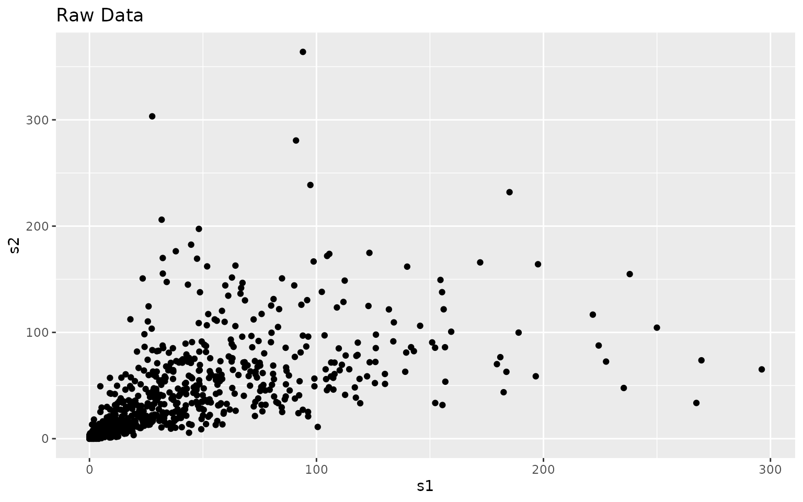
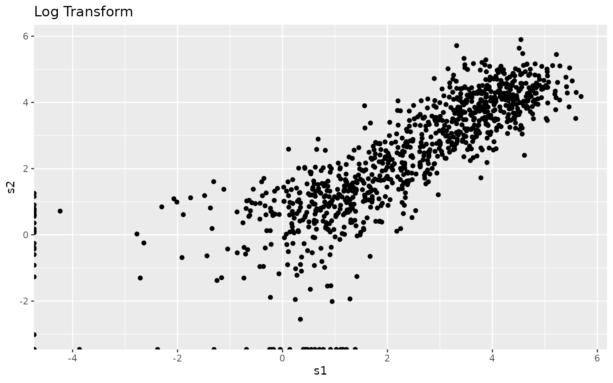
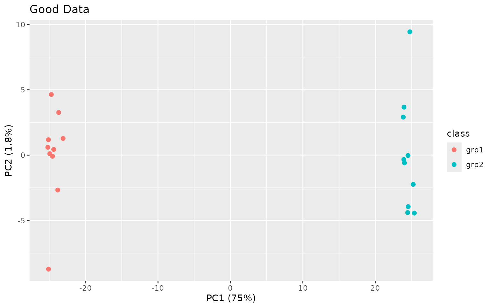
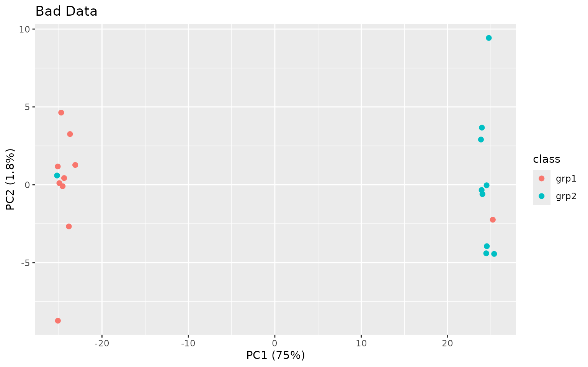
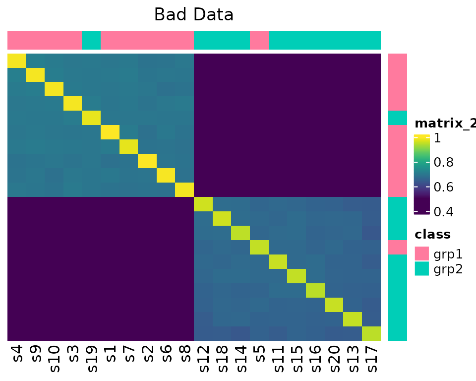
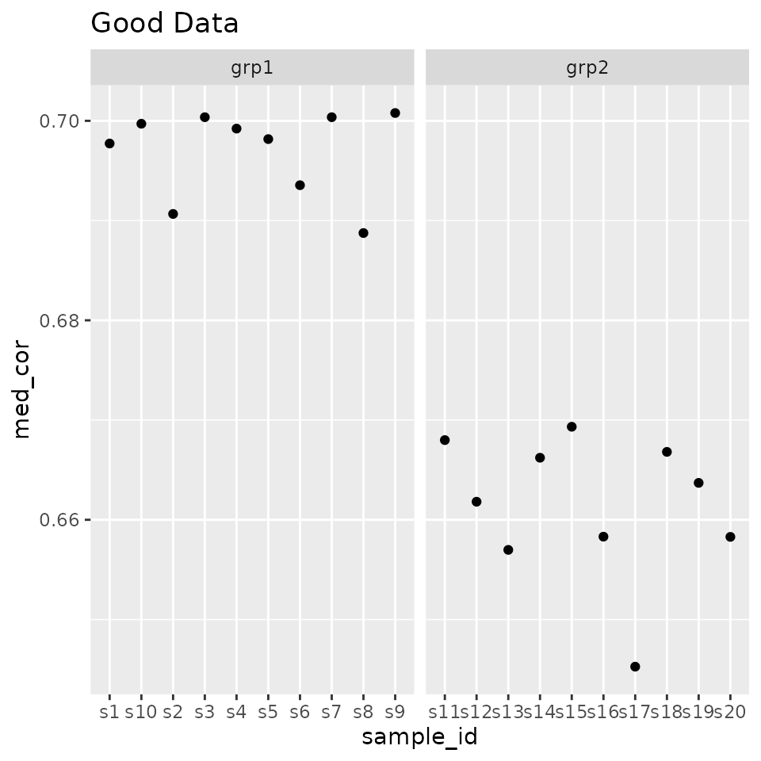
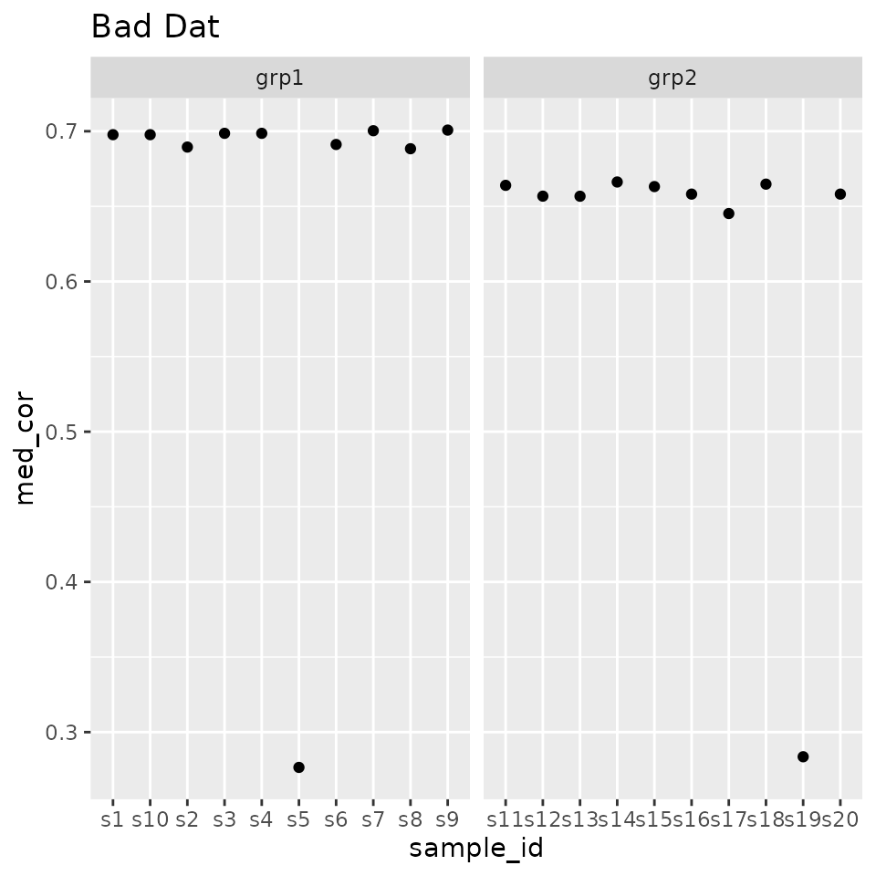
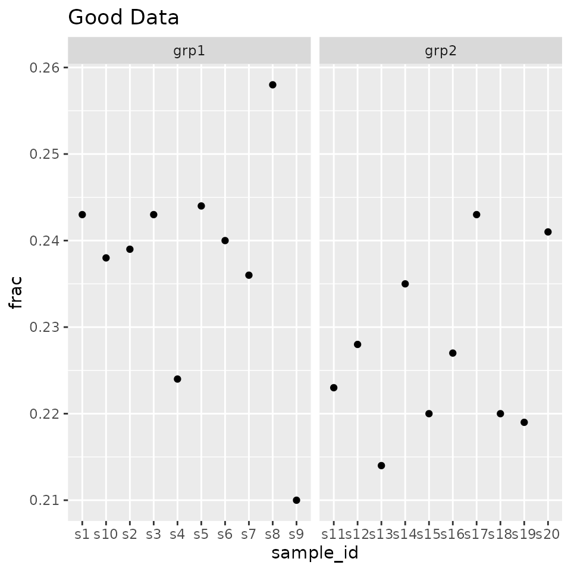
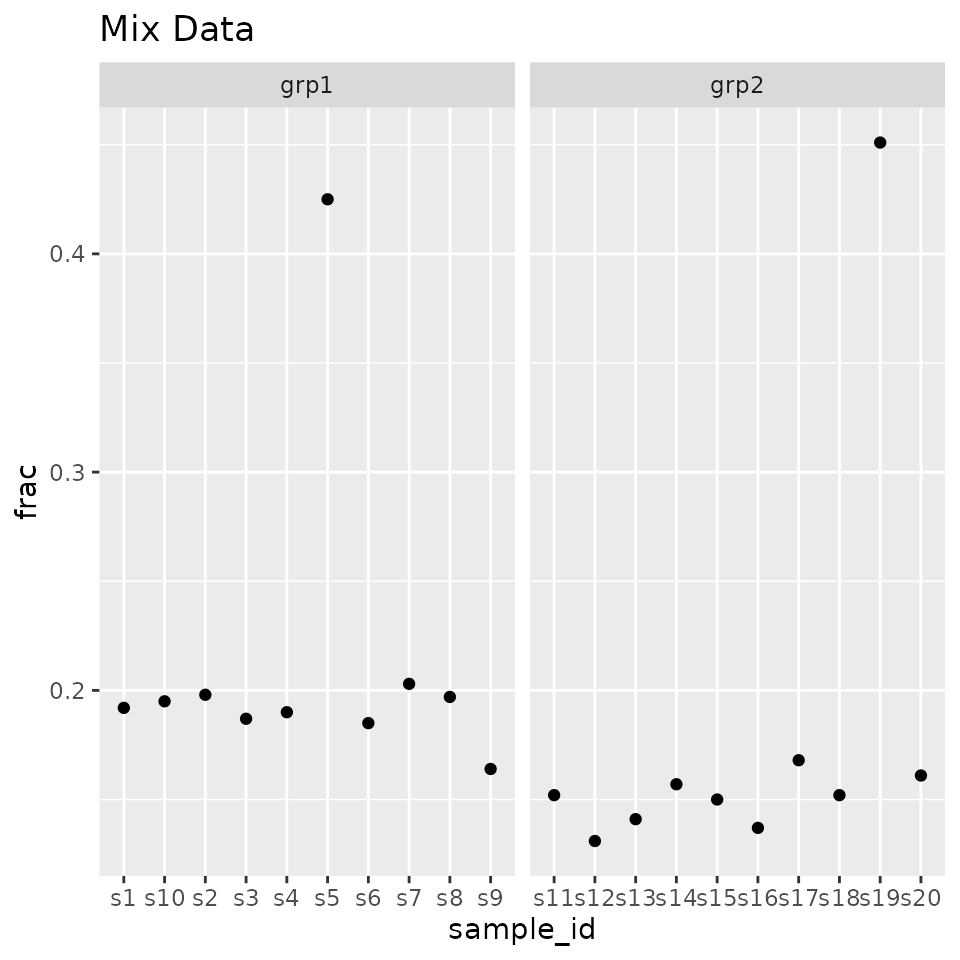

# Quality Control Example

## Introduction

This vignette shows how the various functions in this package can be
used for basic quality control, in addition to advocating a particular
workflow for examining experimental data prior to analysis. These steps
consist of:

- Principal components analysis
- Correlation heatmap
- Median correlation
- Feature outliers

In all of the examples, we will compare and contrast a dataset that is
composed of two different conditions, and the same dataset wherein two
samples have had their class labels switched by mistake, and how the
visualizations above can illustrate potential problems.

## Data

``` r

library(visualizationQualityControl)
library(ggplot2)
data(grp_exp_data)
exp_data <- grp_exp_data$data
rownames(exp_data) <- paste0("f", seq(1, nrow(exp_data)))
colnames(exp_data) <- paste0("s", seq(1, ncol(exp_data)))

sample_info <- data.frame(id = colnames(exp_data), class = grp_exp_data$class)
sample_classes <- sample_info$class

mix_data <- exp_data
mix_data[, 5] <- exp_data[, 19]
mix_data[, 19] <- exp_data[, 5]
```

The data used here are from a simulated experiment, where there are two
classes of samples. 1000 features measured, across 20 samples from 2
groups, with 10 in each group.

The actual values we are going to use are in `exp_data`. The classes of
samples are defined in `sample_classes`. We will also create a version
of the data that has two samples completely switched by accident, labels
and all, in `mix_data`.

``` r

str(exp_data)
```

    ##  num [1:1000, 1:20] 0.833 3.826 15.87 0.842 1.87 ...
    ##  - attr(*, "dimnames")=List of 2
    ##   ..$ : chr [1:1000] "f1" "f2" "f3" "f4" ...
    ##   ..$ : chr [1:20] "s1" "s2" "s3" "s4" ...

``` r

exp_data[1:5, 1:5]
```

    ##            s1       s2        s3        s4       s5
    ## f1  0.8326984 1.795155 0.9698029  0.000000 0.000000
    ## f2  3.8262483 3.103851 1.9064043  3.446350 6.217429
    ## f3 15.8695770 7.078666 5.6856675 11.138222 7.580068
    ## f4  0.8422794 0.000000 1.8026048  0.171272 0.000000
    ## f5  1.8696869 7.724530 3.9550344  1.919573 1.087596

``` r

sample_info
```

    ##     id class
    ## 1   s1  grp1
    ## 2   s2  grp1
    ## 3   s3  grp1
    ## 4   s4  grp1
    ## 5   s5  grp1
    ## 6   s6  grp1
    ## 7   s7  grp1
    ## 8   s8  grp1
    ## 9   s9  grp1
    ## 10 s10  grp1
    ## 11 s11  grp2
    ## 12 s12  grp2
    ## 13 s13  grp2
    ## 14 s14  grp2
    ## 15 s15  grp2
    ## 16 s16  grp2
    ## 17 s17  grp2
    ## 18 s18  grp2
    ## 19 s19  grp2
    ## 20 s20  grp2

## Data Transformation

Before we do anything else, we need to transform the data. This is
because this and other -omics data frequently have a distribution and
error structure that many statistical methods will completely choke on,
or at least give you incorrect results.

**Make sure to ask** if data has been transformed in any way!

Here I will show what the raw and transformed data looks like.

``` r

exp_df = as.data.frame(exp_data)
ggplot(exp_df, aes(x = s1, y = s2)) + geom_point() + labs(title = "Raw Data")
```



Notice the dispersion in the values as the actual values increase. Most
statistical methods don’t like this.

``` r

log_data <- log(exp_data)
```

``` r

log_df = as.data.frame(log_data)
ggplot(log_df, aes(x = s1, y = s2)) + geom_point() + labs(title = "Log Transform")
```



But, lots of other methods don’t deal well with `NA` or `Inf` values,
which is what you get when you do a log-transform on negative or zero
values. There are a couple of solutions:

- If have negatives, add the most negative + small offset
- If have zeros, use `log1p` to handle zero and small values

``` r

log1_data <- log1p(exp_data)

small_value <- min(exp_data[exp_data != 0]) / 100
log2_data <- log2(exp_data + small_value)
```

Most of the methods in this package can handle the presence of `NA` or
`Inf`, except for the principal components analysis (PCA). Because we
have physical data, the lowest value should be zero. Therefore we can
use `log1p`, which will keep the zeros as zeros. Alternatively, we could
use `log1p` for PCA, and `log` for the correlations.

``` r

log_data <- log1p(exp_data)
log_mix <- log1p(mix_data)
```

## Principal Components Analysis

As a first step, we will use principal components analysis (PCA) to
decompose the data. PCA is trying to find linear combinations of the
original variables that account for the maximum amount of variance, and
then finding the next combination that is orthogonal to the first, and
so on and so on. It is extemely useful for confirming that the largest
source of variance is the biological one, and for examining if any
confounds can explain some sources of variance.

``` r

pca_data <- visqc_run_pca(t(log_data))
pca_mixed <- visqc_run_pca(t(log_mix), center = TRUE)
```

### Visualize Them

To visualize the data, we plot the scores. If we want to know how much a
PC contributes to the variances, we can get a summary of them using
`visqc_score_contributions`.

``` r

gd_scores = cbind(pca_data$scores, sample_info)
gd_pca = ggplot(gd_scores, aes(x = PC1, y = PC2, color = class)) + geom_point(size = 2) + ggtitle("Good Data")
gd_pca
```



``` r

knitr::kable(pca_data$variances)
```

|  | pc | variance | percent | cumulative | labels |
|:---|:---|---:|---:|---:|:---|
| PC1 | PC1 | 630.300641 | 0.7474956 | 0.7474956 | PC1 (75%) |
| PC2 | PC2 | 15.260619 | 0.0180981 | 0.7655937 | PC2 (1.8%) |
| PC3 | PC3 | 14.393039 | 0.0170692 | 0.7826629 | PC3 (1.7%) |
| PC4 | PC4 | 13.998044 | 0.0166008 | 0.7992637 | PC4 (1.7%) |
| PC5 | PC5 | 13.624605 | 0.0161579 | 0.8154216 | PC5 (1.6%) |
| PC6 | PC6 | 13.191010 | 0.0156437 | 0.8310653 | PC6 (1.6%) |
| PC7 | PC7 | 12.649098 | 0.0150010 | 0.8460663 | PC7 (1.5%) |
| PC8 | PC8 | 12.395460 | 0.0147002 | 0.8607665 | PC8 (1.5%) |
| PC9 | PC9 | 11.904228 | 0.0141176 | 0.8748841 | PC9 (1.4%) |
| PC10 | PC10 | 11.803515 | 0.0139982 | 0.8888823 | PC10 (1.4%) |
| PC11 | PC11 | 11.425450 | 0.0135498 | 0.9024322 | PC11 (1.4%) |
| PC12 | PC12 | 11.294834 | 0.0133949 | 0.9158271 | PC12 (1.3%) |
| PC13 | PC13 | 10.735845 | 0.0127320 | 0.9285591 | PC13 (1.3%) |
| PC14 | PC14 | 10.627450 | 0.0126035 | 0.9411626 | PC14 (1.3%) |
| PC15 | PC15 | 10.585936 | 0.0125542 | 0.9537168 | PC15 (1.3%) |
| PC16 | PC16 | 10.338576 | 0.0122609 | 0.9659777 | PC16 (1.2%) |
| PC17 | PC17 | 10.188966 | 0.0120835 | 0.9780612 | PC17 (1.2%) |
| PC18 | PC18 | 9.646507 | 0.0114401 | 0.9895013 | PC18 (1.1%) |
| PC19 | PC19 | 8.852683 | 0.0104987 | 1.0000000 | PC19 (1%) |
| PC20 | PC20 | 0.000000 | 0.0000000 | 1.0000000 | PC20 (0.00000000000000000000000000000013%) |

``` r

bad_scores = cbind(pca_mixed$scores, sample_info)
bad_pca <- ggplot(bad_scores, aes(x = PC1, y = PC2, color = class)) + geom_point(size = 2) + ggtitle("Bad Data")
bad_pca
```



``` r

knitr::kable(pca_mixed$variances)
```

|  | pc | variance | percent | cumulative | labels |
|:---|:---|---:|---:|---:|:---|
| PC1 | PC1 | 630.300641 | 0.7474956 | 0.7474956 | PC1 (75%) |
| PC2 | PC2 | 15.260619 | 0.0180981 | 0.7655937 | PC2 (1.8%) |
| PC3 | PC3 | 14.393039 | 0.0170692 | 0.7826629 | PC3 (1.7%) |
| PC4 | PC4 | 13.998044 | 0.0166008 | 0.7992637 | PC4 (1.7%) |
| PC5 | PC5 | 13.624605 | 0.0161579 | 0.8154216 | PC5 (1.6%) |
| PC6 | PC6 | 13.191010 | 0.0156437 | 0.8310653 | PC6 (1.6%) |
| PC7 | PC7 | 12.649098 | 0.0150010 | 0.8460663 | PC7 (1.5%) |
| PC8 | PC8 | 12.395460 | 0.0147002 | 0.8607665 | PC8 (1.5%) |
| PC9 | PC9 | 11.904228 | 0.0141176 | 0.8748841 | PC9 (1.4%) |
| PC10 | PC10 | 11.803515 | 0.0139982 | 0.8888823 | PC10 (1.4%) |
| PC11 | PC11 | 11.425450 | 0.0135498 | 0.9024322 | PC11 (1.4%) |
| PC12 | PC12 | 11.294834 | 0.0133949 | 0.9158271 | PC12 (1.3%) |
| PC13 | PC13 | 10.735845 | 0.0127320 | 0.9285591 | PC13 (1.3%) |
| PC14 | PC14 | 10.627450 | 0.0126035 | 0.9411626 | PC14 (1.3%) |
| PC15 | PC15 | 10.585936 | 0.0125542 | 0.9537168 | PC15 (1.3%) |
| PC16 | PC16 | 10.338576 | 0.0122609 | 0.9659777 | PC16 (1.2%) |
| PC17 | PC17 | 10.188966 | 0.0120835 | 0.9780612 | PC17 (1.2%) |
| PC18 | PC18 | 9.646507 | 0.0114401 | 0.9895013 | PC18 (1.1%) |
| PC19 | PC19 | 8.852683 | 0.0104987 | 1.0000000 | PC19 (1%) |
| PC20 | PC20 | 0.000000 | 0.0000000 | 1.0000000 | PC20 (0.00000000000000000000000000000036%) |

Note in this case **PC1** contains a large proportion of variance, and
separates the samples very well. The PCA plots rarely look this good in
practice!

## Correlation Heatmap

Correlation heatmaps show much of the same information as the PCA plots,
but in a different way.

### Calculate Correlations

We recommend to use our information-content-informed Kendall-tau
{ICIKendallTau::ici_kendalltau} correlation, that is scale invariant,
and includes some effects of missing values. Note that we take the
transpose of the data, because this function assumes that data are
organized with *features* as *columns* and *samples* as *rows*.

``` r

data_cor <- ICIKendallTau::ici_kendalltau(exp_data)
```

This returns a list with some useful information, the actual
correlations in `cor`, the number of points in each correlation in
`count`, and which points pass the various filters in `keep`. We are
really only interested in `cor` in this case.

We can also check that we did the right correlations by looking at the
dimensions of the matrix, in this case we expect a 20 *by* 20 matrix.

``` r

data_cor <- data_cor$cor
dim(data_cor)
```

    ## [1] 20 20

We also do the same for our **mixed-up** data.

``` r

mix_cor <- ICIKendallTau::ici_kendalltau(mix_data)$cor
```

### Reorder Correlations

To make the heatmap more useful, we also do clustering within each of
the **sample classes** and reorder the correlations, this highlights
sub-groups within classes as well as potential outliers.

``` r

data_order <- similarity_reorder(data_cor, transform = "sub_1")
mix_order <- similarity_reorder(mix_cor, transform = "sub_1")
```

### Color by Class

We also want to color them by their class.

``` r

data_legend <- generate_group_colors(2)
names(data_legend) <- c("grp1", "grp2")

row_data <- sample_info[, "class", drop = FALSE]
row_annotation <- list(class = data_legend)
```

### Map Correlation to Color

Correlation values are mapped to colors using the `colorRamp2` function,
by specifying the range of correlations, and what colors to map them to.
Here the `viridis` color-scale is used because it is perceptually
uniform and is good for those suffering from various types of color
blindness. Other choices might be **black -\> white**, or the other
color maps in the `viridis` package. More information about `viridis` is
available [here](http://bids.github.io/colormap/).

``` r

library(viridis)
library(circlize)
colormap <- colorRamp2(seq(0.5, 1, length.out = 20), viridis::viridis(20))
```

### Heatmap!

Finally we can make the heatmaps!

``` r

visqc_heatmap(data_cor, colormap, "Good Data", row_color_data = row_data,
              row_color_list = row_annotation, col_color_data = row_data,
              col_color_list = row_annotation, row_order = data_order$indices,
              column_order = data_order$indices)
```


``` r

visqc_heatmap(mix_cor, colormap, "Bad Data", row_color_data = row_data,
              row_color_list = row_annotation, col_color_data = row_data,
              col_color_list = row_annotation, row_order = mix_order$indices,
              column_order = mix_order$indices)
```



Note in the second example, **s5** and **s19** look odd.

## Median Correlation

Lets also calculate the median correlation within each class.

### Good

``` r

data_medcor <- median_correlations(data_cor, sample_info$class)
```

And plot it using facets in `ggplot2`.

``` r

ggplot(data_medcor, aes(x = sample_id, y = med_cor)) + geom_point() + 
  facet_grid(. ~ sample_class, scales = "free") + ggtitle("Good Data")
```



### Bad

``` r

mix_medcor <- median_correlations(mix_cor, sample_info$class)
```

Plot it!

``` r

ggplot(mix_medcor, aes(x = sample_id, y = med_cor)) + geom_point() +
  facet_grid(. ~ sample_class, scales = "free") + ggtitle("Bad Dat")
```



## Proportion of Outlier Features

For every feature (the rows in our matrix), within each
**sample-class**, calculate the **trimmed** (remove the *x* highest and
lowest values) *mean* and *sd*, which features are outside a given
number of *sd’s*, and then calculate the proportion of outliers in each
sample. Samples with a deviated proportion of outliers should be
examined more closely.

If you are using **metabolomics** data with a large number of zeros, you
probably want to ignore zeros.

### Good

``` r

data_outlier <- outlier_fraction(log_data, sample_info$class, remove_missing = NA)
```

Plot them!

``` r

ggplot(data_outlier, aes(x = sample_id, y = frac)) + geom_point() + 
  facet_grid(. ~ sample_class, scales = "free") + ggtitle("Good Data")
```



### Bad

``` r

mix_outlier <- outlier_fraction(mix_data, sample_info$class, remove_missing = 0)
```

Plot them.

``` r

ggplot(mix_outlier, aes(x = sample_id, y = frac)) + geom_point() + 
  facet_grid(. ~ sample_class, scales = "free") + ggtitle("Mix Data")
```



## Conclusion

Hopefully this has shown how you can use the various tools to examine
your high-througput -omics data for potential problems.
